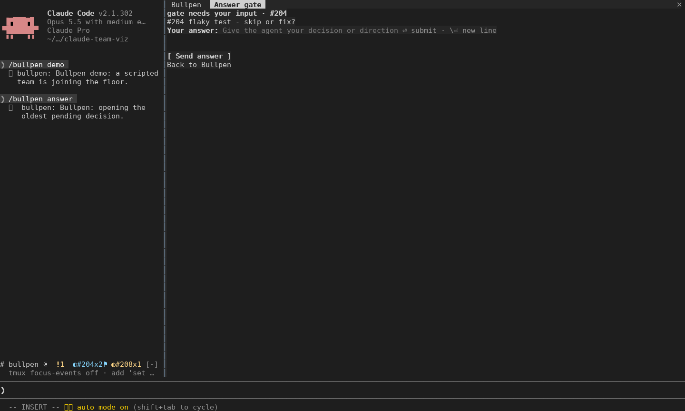

# claude-bullpen

**Bullpen** is a [Claude Code](https://claude.com/claude-code) mod that gives you a live, at-a-glance view of your agent team in the terminal. It's like walking into an organized office: you see who is huddled on which issue, what got sent back, what teammates are saying to each other, and how the burndown is going.

> Personal-use build. Studio and the blocker reply form run inside Claude Code. Native Windows Terminal verification remains ongoing.

The overview surfaces teammates, active issues, and open decisions. Studio puts
people and conversation first; Operations groups activity by workstream. Press an
issue for its cross-agent story, or a teammate name for Claude's transcript.
A flow row shows possible stalls, review pressure, spare capacity, and backlog growth. Brief message and completion highlights give the team a visual pulse.


## Requirements

- Claude Code 2.1.302 (the version used by CI and this release). Older mod-capable builds are not validated.
- Agent teams enabled. In `~/.claude/settings.json`:
  ```json
  { "env": { "CLAUDE_CODE_EXPERIMENTAL_AGENT_TEAMS": "1", "CLAUDE_CODE_ENABLE_TODO_TOOLS": "1" } }
  ```
- A terminal with 24-bit color. Linux terminal captures are verified; Windows Terminal is a target awaiting machine verification.
- Optional, for the burndown: the `gh` CLI, signed in.

## Install

At the prompt of a Claude Code terminal session:

```
/plugin marketplace add nholik/claude-bullpen
/plugin install bullpen@claude-bullpen
```

From a shell:

```
claude plugin marketplace add nholik/claude-bullpen
claude plugin install bullpen@claude-bullpen
```

The marketplace name is `claude-bullpen`, and its root plugin is `bullpen`.
In-session installation opens a details panel; select an install scope and follow
any reload instruction. Syntax checked against the official
[installation documentation](https://code.claude.com/docs/en/discover-plugins).

## Use it at work

Use Claude Code 2.1.302 with mods permitted by your organization's policy. Enable
agent teams before starting Claude Code. For the current PowerShell session:

```powershell
$env:CLAUDE_CODE_EXPERIMENTAL_AGENT_TEAMS = "1"
gh auth login
claude
```

For GitHub Enterprise, authenticate against its host instead:

```powershell
gh auth login --hostname ghe.example.com
```

Bullpen uses the repository resolved by `gh repo view`, including `GH_HOST` when
gh uses it. Its API requests and stored history retain the resolved host. The
read-only GitHub commands are compatible with gh 2.4.0; newer gh is fine too.
Use the normal repository checkout as Claude's working directory.

Put this optional profile in the project's `.claude/bullpen.json`:

```json
{
  "issues": { "filter": "label:sprint-12", "pollSeconds": 60 },
  "glyphs": "ascii",
  "animations": true
}
```

Run `/bullpen` to open the pane, `/bullpen demo` to check it without a live team or
GitHub access, and `/bullpen reload` after editing the profile. `/bullpen live`
returns to the real team. Long asks and story entries wrap; hallway rows remain
single-line. Story panes show the most recent events within their available rows.

When GitHub data is unavailable, the header reports `gh not installed`,
`gh not signed in`, `GitHub SSO authorization required`, `GitHub rate limited`,
`not a GitHub repo`, or `GitHub network unavailable` (timeouts say `gh timed out`).
Unexpected failures show a short gh error. Failed automatic polls back off to
at most ten minutes unless the configured interval is already longer. Successful
automatic polls restore the configured cadence. If exact search totals fail for a
full issue list, the header shows `200+ issues (counts unavailable)`.

Troubleshooting:

- No `/bullpen` command or band: check the Errors tab in `/plugin` and the debug
  log. When managed policy blocks user mods, the guard message names the mod and
  `allowManagedModsOnly`; its hooks do not run. Ask the administrator whether
  Bullpen is permitted. See the official
  [mod policy documentation](https://code.claude.com/docs/en/plugins/mods/admin).
- Glyph boxes or poor font rendering: set `"glyphs":"ascii"`, then `/bullpen reload`.
- Sign-in or SSO: authenticate to the repository's host and authorize the account
  or token for the organization. Use `/bullpen live` for an immediate retry.
- No teammates: the band appears after a teammate joins; `/bullpen demo` checks
  rendering independently. A policy-blocked mod cannot run the demo either.

Windows path handling has automated drive/UNC tests. Real Windows Terminal fonts,
Windows filesystem access and a SAML-protected Enterprise deployment still need
target-machine verification. Known follow-ups are tracked in [#44](https://github.com/nholik/claude-bullpen/issues/44)
through [#47](https://github.com/nholik/claude-bullpen/issues/47), plus a public real-session recording and release tag. ASCII story links and exact-fit story wrapping have automated coverage.

## Your daily view

Run `/bullpen` to open Studio. It puts pending decisions and flow pressure above
shipping and the team. At 72 columns, teammates use compact two-line rows; at
110 and above, cards sit beside the conversation. Click an issue for its story or
a teammate for its transcript.

- **Answer a blocker:** click its amber decision row, press `a` while the pane is
  focused, or run `/bullpen answer`. The reply pane shows the original question
  and a multiline answer field. Enter or **Send answer** delivers your direction
  to the original agent. Failed delivery keeps your draft available for retry.
  “Sent” means queued in the agent's inbox, not confirmed read. Each submitted
  answer resolves that specific request, preserving other pending questions.
- **Notice stalls:** cards explain possible stalls: no tool progress for ten
  minutes, the same command failing three times, repeated review kickbacks,
  idle with open work for five minutes, or review waiting fifteen minutes.
  These are observations, not proof that the agent is stuck. Open the transcript
  before deciding how to intervene.
- **Feel the flow:** message participants briefly light up together; completed
  turns get a short highlight. The flow row shows review queues and idle capacity.
  The footer turns amber when the observed open backlog grows. Counts are net
  changes in your configured issue scope, not estimates of newly created issues.
- **See the team shape:** urgent teammates come first. Long-idle teammates without
  an unresolved ask or stalled assignment fold into an `out:` line after thirty
  minutes. Departed teammates say “clocked out” for two minutes, then disappear.
  Cards show observed turns and active wall time; no token or dollar estimates.
- **Focus:** `s` toggles shipping and `t` toggles conversation. These keys work
  while the pane has keyboard focus. Escape returns to Claude's prompt.
  `/bullpen focus shipping|talk|all` works from the prompt. Old `floor` and
  `huddles` arguments remain aliases for overview and shipping.
- **Replay:** `/bullpen replay PATH` plays a journal directory from its first
  event and holds the last scene. `/bullpen live` returns to your current team.
  Demo and replay never send answers or expose recorded agent IDs as live links;
  the real observers keep recording while you watch.



Journals now stay under `~/.claude/bullpen/<session-id>/` throughout the session,
including before a team forms. Earlier builds may have split a session into two
directories. Replay one directory at a time; it does not silently join old logs.
The in-pane story keeps recent events; live decisions, shipping state and turn
counters survive that display history rolling over.

GitHub polls check up to four referenced PRs per poll, rotating through the team's
tracked PRs. This includes merges made in a
browser or another session. Failed polls retain the last known state. Without
GitHub, the pane continues with locally observed events. A successful compound
shell command is weaker evidence than a GitHub confirmation; remote state wins
when it is newer.

Studio is the supported view. Existing `"style":"operations"` profiles open
Studio as a compatibility alias. No font or terminal graphics support is needed.
Use `"glyphs":"ascii"` if your font shows missing symbols, and
`"animations":false` to disable transient highlights. Small panes retain the
compact fallback; aim for 110–160 pane columns and 32–40 rows when possible.

Recommended GNOME Terminal profile (personal preference; nothing is changed automatically):

- In **Preferences → profile → Text**, try an installed fixed-width font such as
  DejaVu Sans Mono at 11–12 pt. Keep **Cell spacing** width and height at **1.0**
  so pixels and borders meet. See [GNOME's font/spacing settings](https://help.gnome.org/gnome-terminal/app-fonts.html).
- Use a dark background with light text; `#101923` is a good starting point for
  matching the floor. Turn off **Show bold text in bright colors** to keep weight
  independent of color. See [GNOME's color settings](https://help.gnome.org/gnome-terminal/app-colors.html).
- Keep the background opaque and give the pane enough room before shrinking the
  font. Enlarged line spacing can introduce visible seams in half-block sprites.

For Windows Terminal, start with **Cascadia Mono**, normal weight, around 12 pt.
Use an opaque dark background with background images and retro effects off.
These are profile appearance options, described in
[Microsoft's settings reference](https://learn.microsoft.com/en-us/windows/terminal/customize-settings/profile-appearance).
No PowerShell-specific rendering settings are needed. Native Windows font and
raster rendering still require a check on an actual Windows machine.

Graceful fallbacks:

- `"glyphs":"ascii"` keeps the console layout with ASCII borders and symbols.
  It retains issue and teammate links. Below the console minimum, the legacy
  pixel floor becomes a readable one-row team strip.
- Studio briefly highlights both message participants and marks completed turns.
  The pane redraws every second only while such a highlight is fading, and
  otherwise every 15 seconds, so it stays cheap to leave open. Running
  indicators hold steady. `"animations":false` disables the transient
  highlights; activity text and status still update.
- Narrow or short panes show compact cards and explicit overflow counts. On
  surfaces without Raster support, text regions use the available space.
- Status labels accompany color; active, idle, review and decision states do not
  depend on color alone. External names and titles are sanitized to single-cell
  glyphs.

If using tmux, the full palette needs RGB support through tmux as well as the outer
terminal. The screenshot helper uses a separate tmux server with RGB enabled and
leaves your normal tmux configuration alone. The app cannot reliably identify a
broken font; choose ASCII mode explicitly if you see missing glyphs or gaps.

## Use

- `/bullpen` opens the Bullpen pane.
- `/bullpen demo` plays an 80-second scripted team without model calls or GitHub requests. `/bullpen live` restores live data; real observers continue recording during the demo.
- Demo beats: pairing/kickback at 7s, ask at 16s, quiet/stall at 25s, hallway wakes at 35s, issue closes at 55s and 70s, newcomer at 72s. At 25s its simulated clock advances 21 minutes. The final scene stays visible until `/bullpen live`.
- Once a teammate joins, a one-line band shows the team above the prompt. Press `# bullpen` in the band to open the pane.
- Ask Claude to spawn named teammates, for example "Spawn teammates named smith and gate to work on #12 and #14". Each teammate appears in a workstation card with its issue and activity.

## Configure

Optional. Put a `bullpen.json` in your project's `.claude/` folder (`/bullpen reload` rereads it). Every field is optional; a bad field falls back to its default and shows a toast.

```json
{
	"issues": { "filter": "label:sprint-12", "pollSeconds": 60 },
	"roles": {
		"smith": { "role": "builder", "color": "#4fc3f7" },
		"gate": { "role": "reviewer", "color": 3 }
	},
	"animations": true,
	"glyphs": "unicode",
	"palette": ["#4fc3f7", "#ffb74d", "#81c784", "#f06292"]
}
```

- `issues.filter`: a `gh search issues` query (default empty: all issues). State qualifiers are removed so the burndown includes both open and closed issues.
- `issues.pollSeconds`: how often GitHub is polled (default 60, minimum 15).
- `roles`: a teammate name or agent type to `{ role, color }`. `color` is `#rrggbb` or an index into the palette.
- `animations`: set `false` to stop the floor animating (default `true`).
- `style`: `"studio"` (default). The old `"operations"` value is accepted as an alias for Studio.
- `glyphs`: `"unicode"` (default) uses portable single-cell symbols; `"ascii"` uses plain ASCII for fonts that show boxes.
- `palette`: member colors selected by stable teammate name, as `#rrggbb` (default: the built-in palette). Bad entries are dropped with a warning; an empty list keeps the default.

Role colors are shared by the floor, band, huddles and issue stories.

`/bullpen story #208` opens a second pane with the issue’s cross-agent journal
and GitHub state. Press a huddle heading to open its story, or a teammate name
to open Claude’s own transcript. `r` returns from the story. The journal only
contains files/details the collector recorded; it does not reconstruct transcripts.

## Develop

Requires Node 24+. Claude Code is needed for live use and the real plugin tests; the preview is engine-free.

```sh
npm install                    # dev tools: Biome, TypeScript 7, esbuild
claude --plugin-dir .          # load from this folder; hot-reloads on save
npm run check                  # lint + typecheck + vendor check + validate + tests
npm run format                 # Biome format and safe fixes
```

`tsc -p .` (and `npm run check`) needs the API types, which Claude Code writes to `.claude-plugin/types/` (gitignored) the first time it loads the mod.

Preview at a timestamp, export to PNG, or produce animation frames:

```sh
node --experimental-strip-types scripts/preview.ts --cols 72 --rows 32 --at 16 --out .scratch/preview/pane.ansi
python3 scripts/ansi2png.py .scratch/preview/pane.ansi .scratch/preview/pane.png
node --experimental-strip-types scripts/preview.ts --cols 72 --at 55 --frames 24 --out .scratch/preview/close.ansi
node --experimental-strip-types scripts/preview.ts --cols 72 --at 80 --story 204 --out .scratch/preview/story.ansi
```

Omit `--out` to print truecolor ANSI. Frames are 100 ms apart. Check pane body
widths 60, 72, 80, 100, 110 and 160: a 160-column terminal may give the pane only
72 columns. The preview and live demo share collector replay, GitHub parsing,
clock, view-models and animation sampling. PNG conversion uses Pillow and a local
monospace font; the committed images are previews for the lead to replace later.

**Borrowed libraries.** A mod can only import its own files and `claude-code`, so npm libraries are compiled into self-contained modules under `src/vendor/` by `npm run vendor` and committed. The source imports them by relative path. Versions are pinned in `package.json`, and licenses are collected in `src/vendor/LICENSES.md`. To borrow something, add it to `dependencies` and to `scripts/vendor.mjs` (exporting only what's used), write a `.d.ts` beside it, then run `npm run vendor`. Borrowed so far: `culori` (color mixing), `string-width` (display width), `valibot` (schemas), `pathe` (Windows-safe joins), `wrap-ansi` (story/ask wrapping).

Layout:

```
.claude-plugin/   plugin.json, marketplace.json
hooks/            hooks.json + register.tsx (wires events, commands, drawing)
src/              events.ts (normalizing), floor.ts (pixel floor), color.ts
src/vendor/       compiled third-party code (generated; don't edit)
scripts/          vendor.mjs
types/index.d.ts  the mod's state contract
tests/            claude plugin test suites
docs/design.md    design brief: the three questions, layout and moods
```

## License

[MIT](LICENSE)
