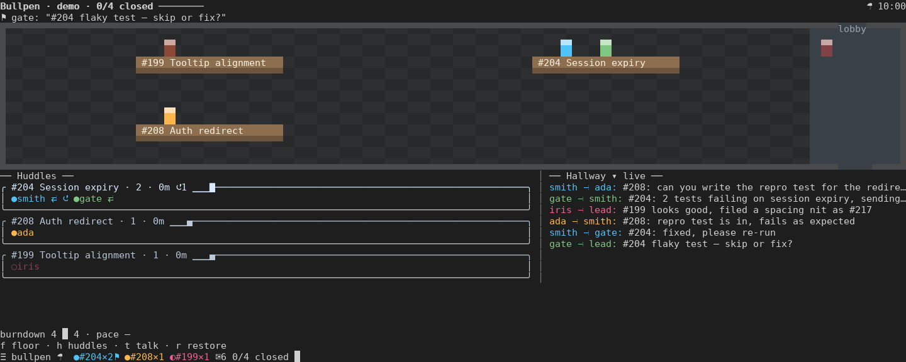

# claude-bullpen

**Bullpen** is a [Claude Code](https://claude.com/claude-code) mod that gives you a live, at-a-glance view of your agent team in the terminal. It's like walking into an organized office: you see who is huddled on which issue, what got sent back, what teammates are saying to each other, and how the burndown is going.

> Status: functional prototype. The images below are deterministic previews; real-terminal UX and Windows Terminal verification remain ongoing.


The header surfaces the next decision and issue progress. Huddles show who is
pairing, where work was sent back, and which issue has stalled. The hallway wakes
when a teammate speaks and collapses after three quiet minutes. Sprites walk
between tables; message dots and close confetti show activity without reading logs.
Morale changes the floor lighting and suggests one check-in. Press a huddle heading
for its cross-agent story, or a teammate name for Claude's transcript.



## Requirements

- Claude Code 2.1.287 or later (mods). Developed on 2.1.302.
- Agent teams enabled. In `~/.claude/settings.json`:
  ```json
  { "env": { "CLAUDE_CODE_EXPERIMENTAL_AGENT_TEAMS": "1", "CLAUDE_CODE_ENABLE_TODO_TOOLS": "1" } }
  ```
- A terminal with 24-bit color. Tested targets: GNOME Terminal and Windows Terminal.
- Optional, for the burndown: the `gh` CLI, signed in.

## Install

At the prompt of a Claude Code terminal session:

```
/plugin install bullpen --marketplace nholik/claude-bullpen
```

From a shell:

```
claude plugin install bullpen --marketplace nholik/claude-bullpen
```

## Use

- `/bullpen` opens the Bullpen pane.
- `/bullpen demo` plays an 80-second scripted team without model calls or GitHub requests. `/bullpen live` restores live data; real observers continue recording during the demo.
- Demo beats: pairing/kickback at 7s, ask at 16s, quiet/stall at 25s, hallway wakes at 35s, issue closes at 55s and 70s, newcomer at 72s. At 25s its simulated clock advances 21 minutes. The final scene stays visible until `/bullpen live`.
- Once a teammate joins, a one-line band shows the team above the prompt. Press `☰ bullpen` in the band to open the pane.
- Ask Claude to spawn named teammates, for example "Spawn teammates named smith and gate to work on #12 and #14". Each teammate appears on the floor at its issue's table, and bobs while it's working.

## Configure

Optional. Put a `bullpen.json` in your project's `.claude/` folder (`/bullpen reload` rereads it). Every field is optional; a bad field falls back to its default and shows a toast.

```json
{
	"issues": { "filter": "is:open label:ready", "pollSeconds": 60 },
	"roles": {
		"smith": { "role": "builder", "color": "#4fc3f7" },
		"gate": { "role": "reviewer", "color": 3 }
	},
	"animations": true,
	"palette": ["#4fc3f7", "#ffb74d", "#81c784", "#f06292"]
}
```

- `issues.filter`: a `gh search issues` query (default empty: all issues). State qualifiers are removed so the burndown includes both open and closed issues.
- `issues.pollSeconds`: how often GitHub is polled (default 60, minimum 15).
- `roles`: a teammate name or agent type to `{ role, color }`. `color` is `#rrggbb` or an index into the palette.
- `animations`: set `false` to stop the floor animating (default `true`).
- `palette`: member colors selected by stable teammate name, as `#rrggbb` (default: the built-in palette). Bad entries are dropped with a warning; an empty list keeps the default.

Colors by role are parsed and available as `colorFor` in `src/profile.ts`; the floor and band don't use them yet (#8).

Pane controls: `f` floor, `h` huddles, `t` talk; press again or `r` to restore.
These keys work while the pane has keyboard focus. Escape returns keyboard focus
to Claude (the mod API does not deliver it). `/bullpen focus floor|huddles|talk|all`
also works from the prompt. The full pixel floor fits pane bodies from 48 columns;
huddles and hallway sit side by side from 60 columns.

`/bullpen story #208` opens a second pane with the issue’s cross-agent journal
and GitHub state. Press a huddle heading to open its story, or a teammate name
to open Claude’s own transcript. `r` returns from the story. The journal only
contains files/details the collector recorded; it does not reconstruct transcripts.

## Develop

Requires Node 24+. Claude Code is needed for live use and the real plugin tests; the preview is engine-free.

```sh
npm install                    # dev tools: Biome, TypeScript 7, esbuild
claude --plugin-dir .          # load from this folder; hot-reloads on save
npm run check                  # lint + typecheck + vendor check + validate + tests
npm run format                 # Biome format and safe fixes
```

`tsc -p .` (and `npm run check`) needs the API types, which Claude Code writes to `.claude-plugin/types/` (gitignored) the first time it loads the mod.

Preview at a timestamp, export to PNG, or produce animation frames:

```sh
node --experimental-strip-types scripts/preview.ts --cols 72 --rows 32 --at 16 --out .scratch/preview/pane.ansi
python3 scripts/ansi2png.py .scratch/preview/pane.ansi .scratch/preview/pane.png
node --experimental-strip-types scripts/preview.ts --cols 72 --at 55 --frames 24 --out .scratch/preview/close.ansi
node --experimental-strip-types scripts/preview.ts --cols 72 --at 80 --story 204 --out .scratch/preview/story.ansi
```

Omit `--out` to print truecolor ANSI. Frames are 100 ms apart. Check pane body
widths 60, 72, 80, 100, 110 and 160: a 160-column terminal may give the pane only
72 columns. The preview and live demo share collector replay, GitHub parsing,
clock, view-models and animation sampling. PNG conversion uses Pillow and a local
monospace font; the committed images are previews for the lead to replace later.

**Borrowed libraries.** A mod can only import its own files and `claude-code`, so npm libraries are compiled into self-contained modules under `src/vendor/` by `npm run vendor` and committed. The source imports them by relative path. Versions are pinned in `package.json`, and licenses are collected in `src/vendor/LICENSES.md`. To borrow something, add it to `dependencies` and to `scripts/vendor.mjs` (exporting only what's used), write a `.d.ts` beside it, then run `npm run vendor`. Borrowed so far: `culori` (color mixing), `string-width` (display width), `valibot` (schemas).

Layout:

```
.claude-plugin/   plugin.json, marketplace.json
hooks/            hooks.json + register.tsx (wires events, commands, drawing)
src/              events.ts (normalizing), floor.ts (pixel floor), color.ts
src/vendor/       compiled third-party code (generated; don't edit)
scripts/          vendor.mjs
types/index.d.ts  the mod's state contract
tests/            claude plugin test suites
docs/design.md    design, mockups, build phases (planned files live there)
```

## License

[MIT](LICENSE)
