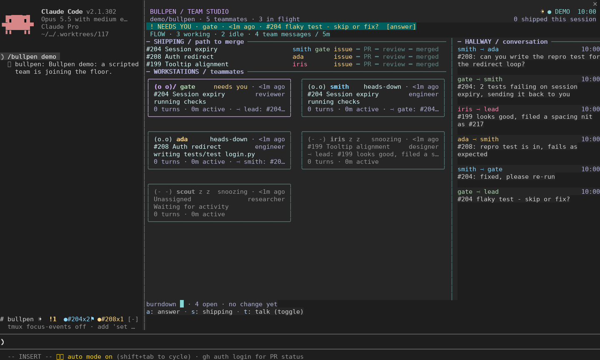

# Bullpen

Bullpen is a [Claude Code](https://claude.com/claude-code) mod that shows your agent
team in a pane next to the conversation. It's built to answer three questions quickly:

1. What needs me?
2. Who is stuck?
3. What is shipping?

It reads what the team is already doing (spawns, turns, tool calls, messages between
teammates) and, if `gh` is signed in, your repository's issues and pull requests.
Apart from the reply form for questions addressed to you, it only observes.



## Requirements

- Claude Code 2.1.302. That's the version CI tests against; older builds that support
  mods may work but aren't tested.
- Agent teams turned on, in `~/.claude/settings.json`:
  ```json
  { "env": { "CLAUDE_CODE_EXPERIMENTAL_AGENT_TEAMS": "1" } }
  ```
- A terminal with 24-bit color. Tested in GNOME Terminal. Windows Terminal is a
  target but hasn't been checked on a real Windows machine yet.
- Optional: the [`gh` CLI](https://cli.github.com/), signed in. Without it you still
  get the team, the hallway and anything Bullpen sees locally, but no issue counts,
  burndown or PR state from GitHub.

## Install

Inside Claude Code:

```
/plugin marketplace add nholik/claude-bullpen
/plugin install bullpen@claude-bullpen
```

Or from a shell:

```sh
claude plugin marketplace add nholik/claude-bullpen
claude plugin install bullpen@claude-bullpen
```

Then run `/bullpen demo` to check that it draws. The demo is a scripted team; it makes
no model calls and no GitHub requests.

## Using it

Run `/bullpen` to open the pane. Once a teammate joins, a one-line band also appears
above the prompt; click the `bullpen` label at its left end to open the pane.

From top to bottom, the pane shows:

- **Header.** The repo, how many teammates and issues are active, a morale glyph,
  and how many PRs have merged this session.
- **Needs you.** Questions a teammate has asked you, oldest first. This row is the
  only thing that pulses, and only for a few seconds when a question arrives. It's
  gone when nothing is waiting.
- **Flow.** Who's working, who's idle, how much the team is talking, and whether
  reviews are piling up.
- **Shipping.** One row per issue in progress, with the teammates on it and where it
  is on the path from issue to PR, review and merge. A stop is only filled in when
  Bullpen has seen it happen.
- **Workstations.** A card per teammate: a face for their mood, name and role, the
  issue they're on, what they're doing right now, and the last thing they said.
  Teammates who need you or look stuck are listed first.
- **Hallway.** Recent messages between teammates. At 110 columns and wider it sits
  in a column on the right.
- **Footer.** The open-issue burndown and the key hints.

Teammates that have been idle for 30 minutes collapse into a single `out:` line,
unless they have a question waiting for you or look stuck. When a teammate leaves, its card says "clocked out" for two
minutes and then goes away.

Click an issue number to see its story: everything the team did on that issue,
merged from every teammate's events. Click a teammate's name to open Claude's own
transcript for that agent.

### What needs you

Needs-you lists only the decisions your lead puts to you: a line starting `Decision:`
in its final answer of a turn (ask your lead to use it). Messages between teammates
never appear there; they stay in the hallway. A decision clears when you send your
next prompt. With nothing waiting there is no row and no key.

With the pane focused, press `n` to list them with the lead's words before each. `j`
and `k` move, Enter puts a quote (`> re #204: skip or fix?`) in your prompt and closes
the pane (it never sends anything), `d` dismisses one for the session, and `n` or Escape
goes back. The first decision pulses for 10 seconds, then holds steady.

### When a card says a teammate might be stuck

A card shows a reason when one of these is true:

- the same command has failed three times in a row
- the issue has been sent back from review twice
- a PR has been waiting for review for 15 minutes
- a running teammate hasn't made tool progress for 10 minutes
- an idle teammate still has an open issue after 5 minutes

These are hints. A teammate thinking through a hard problem can trip the 10-minute
rule. Open the transcript before stepping in.

### Commands

| Command | What it does |
|---|---|
| `/bullpen` | Open the pane |
| `/bullpen demo` | Play the 80-second scripted team |
| `/bullpen live` | Go back to your real team (after a demo or replay), and poll GitHub now |
| `/bullpen answer` | Open the oldest question waiting for you |
| `/bullpen story #123` | Open the story for issue #123 |
| `/bullpen focus shipping\|talk\|all` | Show only shipping, only the hallway, or everything |
| `/bullpen replay PATH` | Replay a recorded session from its journal folder |
| `/bullpen reload` | Re-read `.claude/bullpen.json` |

### Keys

With the pane focused: `n` opens what needs you (when something does), `s` toggles the shipping list, `t` toggles the
hallway. In a story pane, `r` goes back. Escape returns to Claude's prompt.

### Replays and journals

Bullpen writes each session's events to `~/.claude/bullpen/<session-id>/`. To watch a
session again:

```
/bullpen replay ~/.claude/bullpen/<session-id>
```

A replay plays from the first event and holds on the last scene. It never sends
answers. Bullpen keeps the 10 most recent sessions, up to 20 MB in total, and never
touches a session that was active in the last 24 hours.

## Configuration

Everything is optional. Put a `bullpen.json` in your project's `.claude/` folder and run
`/bullpen reload` after editing it. A field Bullpen can't read falls back to its
default and shows a warning.

```json
{
	"issues": { "filter": "label:sprint-12", "pollSeconds": 60 },
	"roles": {
		"smith": { "role": "builder", "color": "#4fc3f7" },
		"gate": { "role": "reviewer", "color": 3 }
	},
	"review": { "requireComment": "Gate: PASS", "bots": ["codex"] },
	"glyphs": "unicode",
	"animations": true,
	"palette": ["#4fc3f7", "#ffb74d", "#81c784", "#f06292"]
}
```

| Field | Default | Meaning |
|---|---|---|
| `issues.filter` | `""` (all issues) | A `gh search issues` query. State qualifiers are dropped so the burndown counts open and closed issues. |
| `issues.pollSeconds` | `60` | How often to poll GitHub. Minimum 15. |
| `roles` | `{}` | Maps a teammate name or agent type to a role label and color. `color` is `#rrggbb` or an index into `palette`. Without an entry, the role comes from the agent type. |
| `review.requireComment` | unset | Extra requirement for merge-ready: the newest comment by an owner, member or collaborator whose first line starts with this marker's first word (`Gate:`) must be exactly `<marker> <head-sha>` (`Gate: PASS 1a2b...`). It also lets a `Gate: PASS` or `Gate: CHANGES` body on `gh pr review` set an issue's review state. |
| `review.bots` | `[]` | Bot reviewers whose completed review of the head is also required. Known: `codex` (the Codex connector's review, with no open P0/P1 findings; a `@codex review` request marks an issue as in review). An unknown name shows a warning. |
| `glyphs` | `"unicode"` | `"ascii"` swaps every symbol and border for plain ASCII. Use it if your font shows boxes. |
| `animations` | `true` | `false` turns off the short highlights for messages and finished turns. Everything else still updates. |
| `palette` | built in | Teammate colors as `#rrggbb`, handed out in the order teammates join. |

## Merge-ready

Without a `review` setting, a PR joins the merge-ready queue on GitHub's own signals:
not a draft, mergeable, its checks passing (or none), no review asking for changes and a
clean merge state. A PR waiting only on a required review is shown as "waiting on
review". `review.requireComment` and `review.bots` add the requirements above; when
either is set, a PR with more comments than Bullpen reads is left out rather than guessed at.

## GitHub

Bullpen uses the repository that `gh repo view` finds from Claude's working
directory, so start Claude in your normal checkout. GitHub Enterprise works the same
way: sign in with `gh auth login --hostname <your-host>`, or set `GH_HOST`. Bullpen
only runs read-only `gh` commands, and works with gh 2.4.0 and later.

Each poll checks up to four of the PRs the team is working on, so a merge done in the
browser or another session still shows up. A merge GitHub confirms is final. For
other states, when GitHub and what Bullpen saw locally disagree, the newer one wins.

If GitHub can't be reached, the header says why: `gh not installed`,
`gh not signed in`, `GitHub SSO authorization required`, `GitHub rate limited`,
`not a GitHub repo`, `GitHub network unavailable` or `gh timed out`. Failed polls
back off to at most every ten minutes. `/bullpen live` retries right away.

## Terminals

Aim for a pane 110 to 160 columns wide and 32 to 40 rows tall. It still works at
72 columns, with teammates as two-line rows instead of cards, and gets more compact
below that.

Previews of the demo: [72 columns](docs/img/studio-72.png) ·
[110 columns](docs/img/studio-110.png) · [160 columns](docs/img/studio-160.png).

Bullpen only draws characters that take one cell, with no emoji, so any monospace
font with box drawing should be fine. In GNOME Terminal, DejaVu Sans Mono at 11 or
12 pt with cell spacing left at 1.0 works well. In Windows Terminal, start with
Cascadia Mono. In tmux, you need RGB color turned on for the full palette (for
example `set -as terminal-features ",*:RGB"`).

The pane redraws every 15 seconds while nothing is happening, and once a second
while a highlight fades, so it's cheap to leave open.

## Troubleshooting

- **No `/bullpen` command.** Look at the Errors tab in `/plugin`. If your organization
  limits mods with `allowManagedModsOnly`, Bullpen won't load until an admin allows
  it. See the [mod admin docs](https://code.claude.com/docs/en/plugins/mods/admin).
- **No band above the prompt.** The band appears once a teammate joins. `/bullpen`
  opens the pane without one.
- **Boxes or gaps instead of symbols.** Set `"glyphs": "ascii"` and run
  `/bullpen reload`.
- **No GitHub data.** Read the reason in the header, fix it (usually `gh auth login`,
  or authorizing your token for SSO), then run `/bullpen live`.

## Limits

- It's tested on Linux. Windows path handling has automated tests, but Windows
  Terminal and a SAML-protected GitHub Enterprise haven't been tried on real machines.
- It doesn't estimate tokens or cost. Cards count turns and active time.
- Stuck reasons are hints from what Bullpen can see, not a diagnosis.
- An issue's story contains what Bullpen recorded. It doesn't rebuild full transcripts.

## Development

You need Node 24 or later.

```sh
npm install              # Biome, TypeScript, esbuild
claude --plugin-dir .    # load the mod from this folder; reloads on save
npm run check            # lint, typecheck, vendor check, plugin validate, tests
npm run format
```

`npm run check` needs the API types in `.claude-plugin/types/`, which Claude Code
writes the first time it loads the mod. `scripts/ci-types.sh` writes them without
signing in.

To look at the UI without Claude Code:

```sh
node --experimental-strip-types scripts/preview.ts --cols 110 --at 16
```

That prints the demo at second 16 as ANSI. `--out file.ansi` saves it, and
`python3 scripts/ansi2png.py` turns that into a PNG. `--journal <dir>` renders a
real session instead of the demo. `scripts/snap.sh` takes a real screenshot of
`/bullpen demo` running in tmux.

A mod can only import its own files and `claude-code`, so the few npm libraries
Bullpen uses are compiled into `src/vendor/` by `npm run vendor` and committed. Their
licenses are in `src/vendor/LICENSES.md`.

```
.claude-plugin/   plugin.json, marketplace.json
hooks/            register.tsx wires events, commands and drawing
src/              collecting, the model, rendering, GitHub, the journal
src/vendor/       compiled third-party code (generated)
types/index.d.ts  the mod's state
tests/            claude plugin test suites
docs/design.md    the design brief
```

`docs/design.md` explains what the pane is for and the rules every visual change
is held to. `CLAUDE.md` has the conventions for working on the code.

## License

[MIT](LICENSE)
